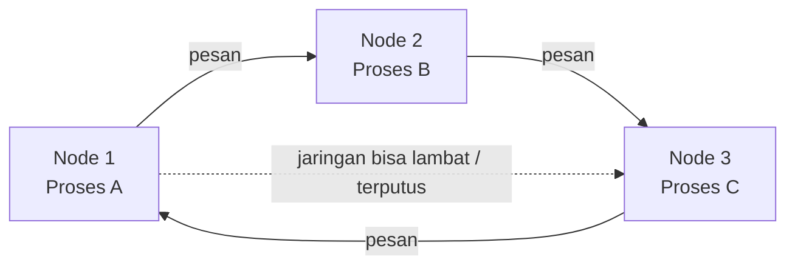
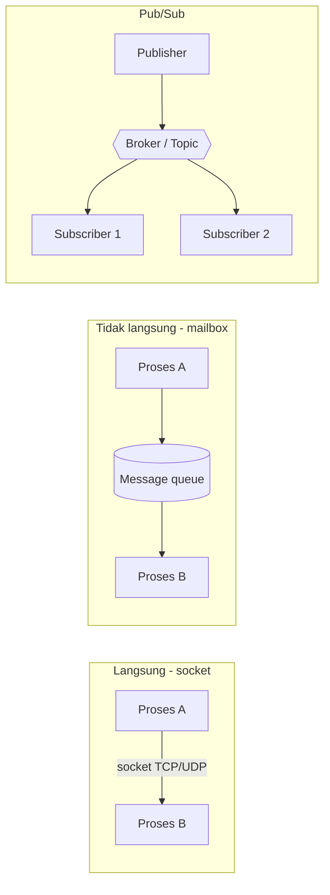
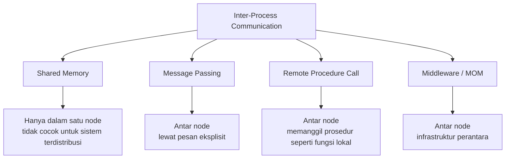
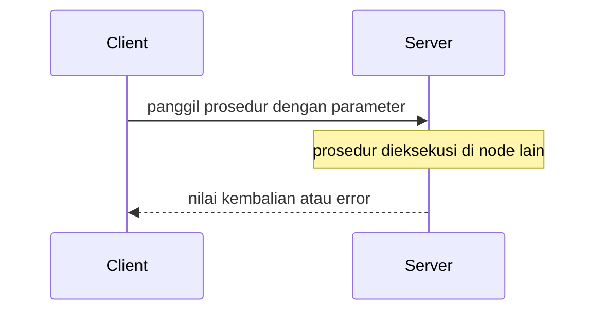
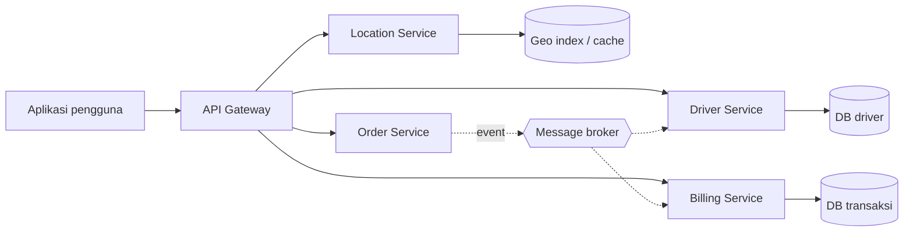
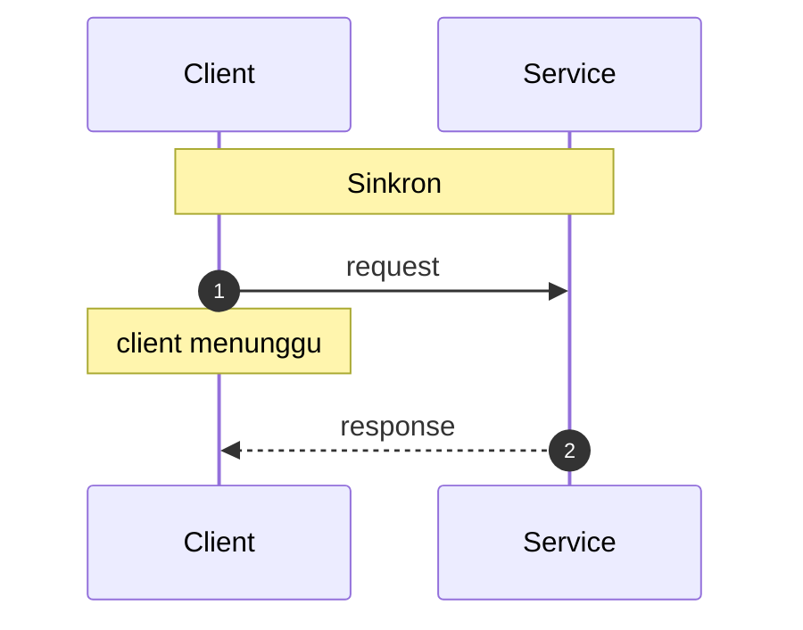
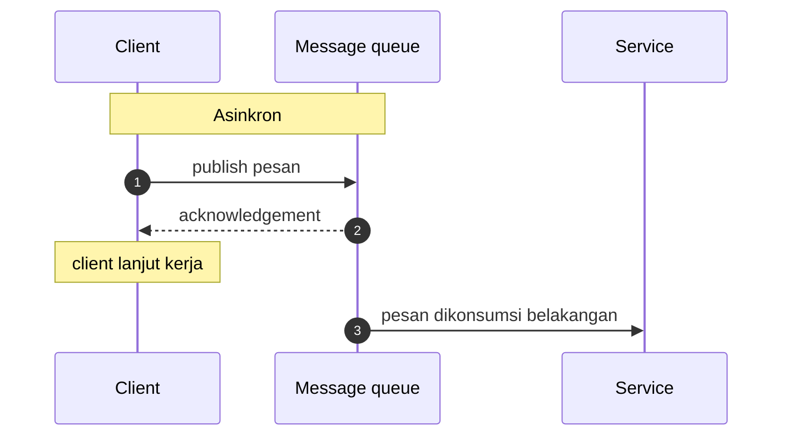
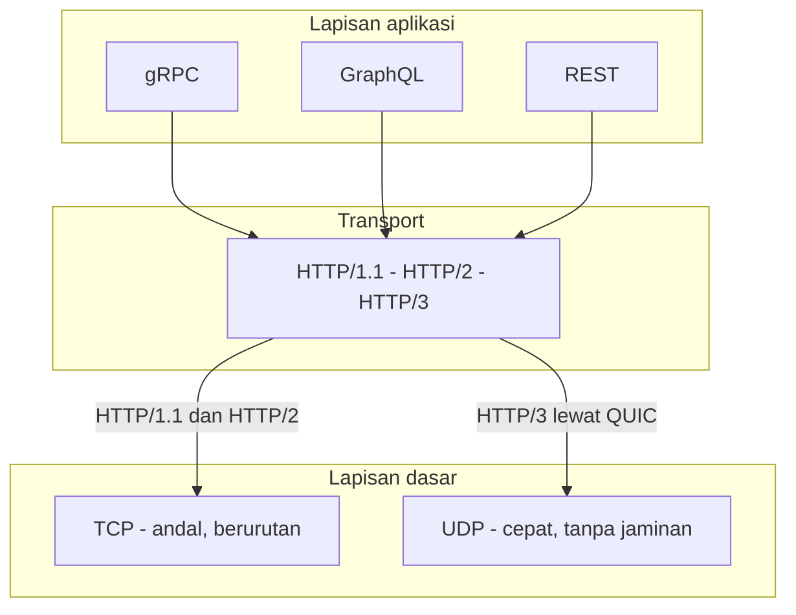
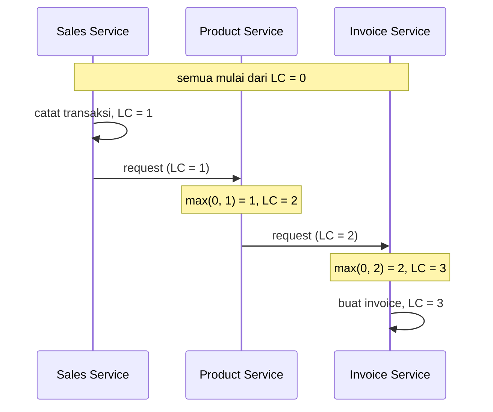

# Ringkasan Materi Minggu ke-2, Proses dan Komunikasi Antar Proses

Mata kuliah: Sistem Terdistribusi dan Terdesentralisasi<br>
Topik: Proses dan Komunikasi Antar Proses pada Sistem Terdistribusi<br>
Dosen: Dr. Bambang Purnomosidi D. P.<br>
Kode: FIF25002T | SKS: 3 | Prodi: Informatika, FTI UTDI

---

## Tujuan pembelajaran

- Mampu menjelaskan konsep proses pada sistem terdistribusi
- Mampu menjelaskan berbagai jenis komunikasi antar proses (IPC)
- Mampu menganalisis isu sinkronisasi, reliabilitas, dan keamanan pada sistem terdistribusi
- Mampu mengaitkan konsep ke contoh nyata seperti microservices, cloud, maupun distributed messaging

---

## 1. Apa itu proses

<p align="justify"><strong>Proses adalah program yang sedang dieksekusi.</strong> Program hanyalah berkas pasif di disk, sedangkan proses adalah wujud aktifnya di memori. Di dalamnya ada kode yang dijalankan, data yang diolah, <em>stack</em> untuk pemanggilan fungsi, dan <em>program counter</em> yang menunjuk instruksi berikutnya. Setiap proses mendapat ruang alamat sendiri, sehingga proses yang satu tidak bisa seenaknya menulis ke memori proses lain.</p>

<p align="justify">Sistem operasi menyimpan keterangan tiap proses dalam struktur yang biasa disebut <em>Process Control Block</em> (PCB). Isinya antara lain identitas proses, status (berjalan, siap, menunggu), isi register, dan informasi memori. Ketika CPU berpindah dari satu proses ke proses lain, OS melakukan <em>context switch</em>, yaitu menyimpan keadaan proses lama lalu memuat keadaan proses baru.</p>

<p align="justify">Pemahaman ini penting karena seluruh pembahasan berikutnya bertumpu pada satu kenyataan, yaitu <strong><em>proses adalah unit kerja yang berjalan di dalam sebuah node, dan di sistem terdistribusi unit itu tersebar di banyak mesin.</em></strong></p>

---

## 2. Manajemen proses

<p align="justify">Ada tiga kegiatan pokok dalam mengelola proses, dan ketiganya menjadi makin rumit ketika proses tidak lagi tinggal di satu komputer.</p>

<p align="center">Tabel 1: Kegiatan manajemen proses</p>

<table align="center">
  <thead>
    <tr>
      <th>Kegiatan</th>
      <th>Isi</th>
      <th>Catatan pada sistem terdistribusi</th>
    </tr>
  </thead>
  <tbody>
    <tr>
      <td>Process creation</td>
      <td>Membuat proses baru, menentukan program, sumber daya, dan hak aksesnya</td>
      <td>Proses bisa lahir di node mana saja, bahkan dipicu oleh permintaan yang datang dari node lain</td>
    </tr>
    <tr>
      <td>Process migration</td>
      <td>Memindahkan proses yang sedang berjalan dari satu mesin ke mesin lain</td>
      <td>Berguna untuk <em>load balancing</em>, penghematan energi, atau memindahkan beban menjauh dari node yang akan dimatikan</td>
    </tr>
    <tr>
      <td>Process monitoring</td>
      <td>Mengawasi status, pemakaian CPU dan memori, serta kesehatan proses</td>
      <td>Menjadi dasar <em>observability</em>: metrik, log, dan <em>tracing</em> dikumpulkan dari banyak node sekaligus</td>
    </tr>
  </tbody>
</table>

<p align="justify"><em>Process migration</em> bukan pekerjaan sepele. Keadaan proses, termasuk memori dan koneksi jaringan yang sedang terbuka, harus ikut berpindah tanpa merusak pekerjaan yang sedang berjalan. Karena itu di praktiknya lebih sering dipakai pendekatan yang lebih sederhana. Proses lama dimatikan, lalu proses baru dijalankan di node tujuan dengan status yang sudah disimpan.</p>

---

## 3. Sistem terdistribusi dan kebutuhan komunikasi

<p align="justify">Sistem terdistribusi adalah sekumpulan komputer atau <em>nodes</em> yang independen dan bekerja bersama dalam satu koordinasi sehingga tampak sebagai satu kesatuan logis. Setiap node menjalankan prosesnya sendiri, dengan sistem operasi, memori, dan clock lokal masing-masing.</p>

<p align="justify"><strong>Agar bisa bekerja sebagai satu sistem logis, node-node itu harus berkomunikasi.</strong> Rantainya sederhana tetapi berulang. Node yang menjalankan proses berhubungan dengan node lain yang juga menjalankan proses, lalu dengan node berikutnya, dan seterusnya. Dari situlah muncul kebutuhan komunikasi antar proses di berbagai node, atau yang biasa disebut IPC.</p>



<p align="center">Gambar 1: Node-node independen yang saling berkomunikasi sebagai satu sistem logis</p>

<p align="justify">Beberapa contoh nyata yang dipakai di kelas adalah sebagai berikut.</p>

- **Multiplayer game.** Gerakan pemain di satu perangkat harus segera terlihat oleh pemain lain, padahal keduanya terhubung ke server yang berbeda.
- **Gojek/Grab.** Antarmuka pengguna berkomunikasi dengan banyak layanan sekaligus, yaitu layanan driver, pelacakan lokasi, penghitungan biaya, dan lain-lain.
- **Chat dan video call WhatsApp.** Percakapan bersifat <em>point-to-point</em>, tetapi berjalan di atas infrastruktur yang terdistribusi.

---

## 4. Model komunikasi pesan

<p align="justify">Secara garis besar ada tiga cara proses bertukar pesan. Perbedaannya terletak pada apakah pengirim harus tahu identitas penerima, dan apakah pesan dititipkan lewat perantara.</p>



<p align="center">Gambar 2: Tiga model komunikasi pesan</p>

<p align="center">Tabel 2: Perbandingan model komunikasi pesan</p>

<table align="center">
  <thead>
    <tr>
      <th>Model</th>
      <th>Cara kerja</th>
      <th>Konsekuensi</th>
    </tr>
  </thead>
  <tbody>
    <tr>
      <td>Langsung</td>
      <td>Pengirim dan penerima terhubung lewat socket, masing-masing tahu alamat lawannya</td>
      <td>Sederhana dan cepat, tetapi keduanya harus hidup pada saat bersamaan</td>
    </tr>
    <tr>
      <td>Tidak langsung</td>
      <td>Pesan dititipkan ke mailbox atau message queue, penerima mengambilnya belakangan (contoh: perintah <code>write</code> di Linux)</td>
      <td>Pengirim dan penerima tidak perlu aktif bersamaan, tetapi ada antrean yang harus dikelola</td>
    </tr>
    <tr>
      <td>Pub/Sub</td>
      <td>Pengirim menerbitkan pesan ke sebuah topik, semua pelanggan topik itu menerimanya</td>
      <td>Satu pesan bisa sampai ke banyak penerima tanpa pengirim tahu siapa saja mereka</td>
    </tr>
  </tbody>
</table>

<p align="justify"><strong><em>Perbedaan paling penting bukan pada teknologinya, melainkan pada tingkat keterikatan. Komunikasi langsung mengikat pengirim ke penerima, sedangkan pub/sub melepaskannya.</em></strong></p>

---

## 5. Proses pada sistem terdistribusi

<p align="justify">Di satu komputer, dua proses bisa berbagi memori. Caranya, OS menyediakan satu area memori yang dipetakan ke ruang alamat kedua proses, lalu keduanya membaca dan menulis di area yang sama. Cara ini sangat cepat karena tidak ada data yang perlu disalin lewat jaringan.</p>

<p align="justify">Di sistem terdistribusi hal itu tidak mungkin. Proses berada di node yang berbeda, dan <strong>tidak ada shared memory antar node</strong>. Satu-satunya jalur yang tersedia adalah jaringan, sehingga semua pertukaran data harus berbentuk pesan yang dikirim dan diterima.</p>

<p align="justify"><strong><em>Karena tidak ada memori bersama, IPC khusus untuk sistem terdistribusi menjadi keharusan, bukan pilihan.</em></strong> Konsekuensinya juga jelas. Setiap komunikasi punya biaya <em>latency</em>, bisa gagal di tengah jalan, dan bisa tiba tidak sesuai urutan.</p>

---

## 6. Empat jenis IPC

<p align="justify">Secara umum ada empat jenis IPC yang dikenal. Satu di antaranya hanya bekerja di dalam satu node, sedangkan tiga lainnya dirancang untuk melintasi jaringan.</p>



<p align="center">Gambar 3: Empat jenis IPC dan posisinya</p>

<p align="center">Tabel 3: Empat jenis IPC</p>

<table align="center">
  <thead>
    <tr>
      <th>Jenis</th>
      <th>Cara kerja</th>
      <th>Cocok untuk sistem terdistribusi?</th>
    </tr>
  </thead>
  <tbody>
    <tr>
      <td>Shared memory</td>
      <td>Dua proses memetakan satu area memori yang sama</td>
      <td>Tidak, karena memori tidak bisa dibagi antar node</td>
    </tr>
    <tr>
      <td>Message passing</td>
      <td>Proses mengirim dan menerima pesan secara eksplisit</td>
      <td>Ya, menjadi dasar sebagian besar komunikasi terdistribusi</td>
    </tr>
    <tr>
      <td>Remote Procedure Call</td>
      <td>Proses memanggil prosedur di node lain seolah fungsi lokal</td>
      <td>Ya, dipakai luas pada layanan modern</td>
    </tr>
    <tr>
      <td>Middleware</td>
      <td>Lapisan perangkat lunak yang mengatur pertukaran pesan dan data</td>
      <td>Ya, menyembunyikan kerumitan jaringan dari aplikasi</td>
    </tr>
  </tbody>
</table>

<p align="justify"><strong><em>Shared memory tetap berguna, tetapi perannya berubah karena ia dipakai di dalam satu node untuk mempercepat pertukaran data, bukan untuk menghubungkan node yang berbeda.</em></strong></p>

---

## 7. Message passing dan MPI

<p align="justify">Message passing adalah bentuk komunikasi paling mendasar. Pengirim menyusun pesan, menentukan tujuan, lalu mengirimkannya. Penerima menunggu pesan datang, membacanya, dan memproses isinya. Tidak ada memori bersama yang perlu dijaga, hanya pesan yang harus sampai dengan utuh.</p>

<p align="justify">Untuk membuat cara kerja ini seragam, dipakai standar bernama <strong>MPI (Message Passing Interface)</strong> yang dikelola MPI Forum. Slide menyebut versi terakhir 5.0 (per Oktober 2026). Implementasinya banyak, salah satunya <code>mpi4py</code> untuk Python.</p>

```python
from mpi4py import MPI

comm = MPI.COMM_WORLD
rank = comm.Get_rank()

if rank == 0:
    comm.send({"pesan": "halo dari rank 0"}, dest=1)
elif rank == 1:
    data = comm.recv(source=0)
    print(data)
```

<p align="justify">Contoh di atas menunjukkan dua operasi dasar, yaitu <code>send</code> untuk mengirim dan <code>recv</code> untuk menerima. Pada program nyata, MPI dipakai untuk komputasi paralel berskala besar, misalnya simulasi fisika atau pelatihan model, di mana ratusan proses bekerja pada satu masalah yang sama dan bertukar sebagian hasil di antara mereka.</p>

<p align="justify">MPI menyediakan dua gaya pengiriman. <strong>Blocking</strong> membuat pengirim menunggu sampai pesan benar-benar terkirim atau diterima, sedangkan <strong>non-blocking</strong> mengembalikan kendali lebih cepat sehingga proses bisa mengerjakan hal lain sambil menunggu. Pilihan ini memengaruhi kinerja dan kemudahan penulisan program.</p>

---

## 8. RPC dan gRPC

<p align="justify">Remote Procedure Call membuat pemanggilan lintas jaringan terasa seperti pemanggilan fungsi biasa. Program cukup memanggil <code>hitungBiaya(...)</code>, dan seolah-olah fungsi itu ada di komputer sendiri. Di balik layar, lapisan RPC mengubah panggilan tersebut menjadi pesan, mengirimkannya, menunggu jawaban, lalu mengembalikan hasilnya.</p>



<p align="center">Gambar 4: Alur pemanggilan RPC</p>

<p align="justify">Kemudahan itu menyembunyikan satu hal penting. <strong><em>Panggilan RPC tetap melintasi jaringan, sehingga bisa lambat, gagal, atau terkirim dua kali.</em></strong> Pemanggilan fungsi lokal tidak pernah punya risiko seperti itu. Karena itu RPC yang baik menyertakan <em>timeout</em>, percobaan ulang yang aman, dan penanganan kegagalan yang jelas.</p>

<p align="justify">Contoh RPC modern yang paling banyak dipakai adalah <strong>gRPC</strong>. Layanannya didefinisikan lebih dulu dalam berkas <em>Interface Definition Language</em>, lalu kode klien dan server dibangkitkan otomatis dari definisi tersebut.</p>

```proto
service Penjualan {
  rpc CatatTransaksi (Transaksi) returns (Hasil);
}
```

<p align="justify">gRPC berjalan di atas HTTP/2 sehingga mendukung banyak permintaan dalam satu koneksi, serta komunikasi dua arah yang mengalir terus-menerus (<em>streaming</em>). Format datanya biasanya Protocol Buffers yang lebih ringkas daripada JSON.</p>

---

## 9. MOM (Message-Oriented Middleware)

<p align="justify"><strong>MOM adalah infrastruktur yang memfasilitasi komunikasi dan pertukaran data melalui pesan.</strong> Infrastruktur ini memungkinkan transfer data antar aplikasi melalui saluran komunikasi yang membawa unit informasi mandiri yang disebut <em>message</em>. Ciri utamanya adalah pesan dikirim dan diterima secara <strong>asinkron</strong> dalam lingkungan berbasis MOM.</p>

<p align="justify">Karena pengirim tidak perlu menunggu penerima siap, MOM menjadi tulang punggung sistem yang harus tetap responsif walaupun salah satu layanan sedang lambat atau mati sementara. Pesan menunggu di antrean sampai ada yang mengambilnya.</p>

<p align="center">Tabel 4: Standar dan protokol MOM</p>

<table align="center">
  <thead>
    <tr>
      <th>Standar / protokol</th>
      <th>Keterangan</th>
    </tr>
  </thead>
  <tbody>
    <tr>
      <td>XATMI</td>
      <td>Spesifikasi X/Open Group untuk <em>Distributed Transaction Processing</em></td>
    </tr>
    <tr>
      <td>AMQP</td>
      <td><em>Advanced Message Queuing Protocol</em>, umum dipakai aplikasi enterprise</td>
    </tr>
    <tr>
      <td>HLA IEEE 1516</td>
      <td>Standar dari IEEE dan SISO untuk interoperabilitas simulasi terdistribusi</td>
    </tr>
    <tr>
      <td>MQTT</td>
      <td><em>MQ Telemetry Transport</em>, cocok untuk perangkat dengan sumber daya terbatas (IoT)</td>
    </tr>
    <tr>
      <td>DDS</td>
      <td><em>Data Distribution Service</em> dari OMG, menekankan komunikasi <em>real-time</em></td>
    </tr>
    <tr>
      <td>XMPP</td>
      <td><em>eXtensible Messaging and Presence Protocol</em>, berbasis XML dan banyak dipakai untuk perpesanan</td>
    </tr>
  </tbody>
</table>

<p align="justify">Contoh implementasi MOM yang sering dipakai adalah RabbitMQ, Apache Kafka, Apache ActiveMQ, dan NATS. <strong><em>Yang dijual MOM bukan kecepatan mentah, melainkan keandalan pengiriman dan pelepasan ketergantungan waktu antara pengirim dan penerima.</em></strong></p>

---

## 10. Studi kasus microservices

<p align="justify">Microservices memecah satu aplikasi besar menjadi banyak layanan kecil yang berdiri sendiri. Setiap layanan punya tanggung jawab sempit, bisa dikembangkan dan diterapkan secara terpisah, serta berkomunikasi dengan layanan lain lewat jaringan. Pola ini sangat bergantung pada IPC yang sudah dibahas sebelumnya.</p>



<p align="center">Gambar 5: Pola komunikasi layanan pada aplikasi ride-hailing</p>

<p align="justify">Pada aplikasi seperti Gojek atau Grab, permintaan pengguna masuk lewat API Gateway. Layanan order mencari driver terdekat, layanan lokasi terus memperbarui posisi, dan layanan biaya menghitung tarif. Sebagian panggilan bersifat sinkron karena pengguna menunggu jawaban, sebagian lain dikirim sebagai <em>event</em> ke broker karena tidak perlu ditunggu.</p>

<p align="justify">Keuntungannya, tiap layanan bisa diskalakan sendiri sesuai beban. Harganya, sistem menjadi jauh lebih rumit karena satu permintaan pengguna bisa melewati belasan layanan, sehingga kegagalan, keterlambatan, dan urutan kejadian harus dipikirkan dengan saksama.</p>

---

## 11. Komunikasi sinkron dan asinkron

<p align="justify">Pembedaan ini menyangkut siapa yang menunggu siapa. Pada komunikasi <strong>sinkron</strong>, pengirim menunggu sampai penerima memberikan jawaban. Pada komunikasi <strong>asinkron</strong>, pengirim menitipkan pesan lalu melanjutkan pekerjaannya tanpa menunggu hasil.</p>



<p align="center">Gambar 6: Komunikasi sinkron</p>



<p align="center">Gambar 7: Komunikasi asinkron</p>

<p align="center">Tabel 5: Perbandingan komunikasi sinkron dan asinkron</p>

<table align="center">
  <thead>
    <tr>
      <th>Aspek</th>
      <th>Sinkron</th>
      <th>Asinkron</th>
    </tr>
  </thead>
  <tbody>
    <tr>
      <td>Pengirim</td>
      <td>Menunggu jawaban sebelum lanjut</td>
      <td>Langsung lanjut setelah pesan dikirim</td>
    </tr>
    <tr>
      <td>Keterikatan waktu</td>
      <td>Kedua pihak harus aktif bersamaan</td>
      <td>Penerima boleh belum siap</td>
    </tr>
    <tr>
      <td>Kecepatan tanggap</td>
      <td>Hasil langsung diketahui</td>
      <td>Hasil menyusul, perlu mekanisme pemberitahuan</td>
    </tr>
    <tr>
      <td>Ketahanan saat penerima mati</td>
      <td>Permintaan gagal</td>
      <td>Pesan menunggu di antrean</td>
    </tr>
    <tr>
      <td>Contoh</td>
      <td>gRPC, REST, RPC</td>
      <td>Message queue, pub/sub, MOM</td>
    </tr>
  </tbody>
</table>

<p align="justify"><strong><em>Tidak ada yang selalu lebih baik. Sinkron dipilih ketika jawaban dibutuhkan saat itu juga, asinkron dipilih ketika pekerjaan boleh selesai belakangan asalkan tidak hilang.</em></strong> Banyak sistem memakai keduanya. Panggilan ke pengguna bersifat sinkron, sedangkan proses lanjutan seperti pengiriman email atau pembaruan stok berjalan asinkron.</p>

---

## 12. Berbagai masalah pada komunikasi antar proses

<p align="justify">Memindahkan data lewat jaringan memunculkan masalah yang tidak ada pada pemanggilan fungsi biasa. Empat di antaranya paling sering dibahas.</p>

<p align="center">Tabel 6: Masalah pada komunikasi antar proses</p>

<table align="center">
  <thead>
    <tr>
      <th>Masalah</th>
      <th>Penjelasan</th>
      <th>Solusi</th>
    </tr>
  </thead>
  <tbody>
    <tr>
      <td>Reliability</td>
      <td>Pesan harus terkirim lengkap dan dalam urutan benar, bahkan saat ada paket hilang atau sistem <em>crash</em></td>
      <td><em>Acknowledgement</em>, transmisi ulang, protokol transport andal seperti TCP</td>
    </tr>
    <tr>
      <td>Ordering</td>
      <td>Pesan harus diproses dalam urutan yang dapat diprediksi dan logis</td>
      <td>Pipe FIFO, message queue, shared memory, socket dan message passing, RPC</td>
    </tr>
    <tr>
      <td>Security</td>
      <td>Pesan tidak boleh dibaca atau diubah pihak lain, dan pengirim harus terverifikasi</td>
      <td>Enkripsi, autentikasi</td>
    </tr>
    <tr>
      <td>Performance</td>
      <td>Setiap perjalanan lewat jaringan menambah waktu dan memakan lebar pita</td>
      <td>Menekan <em>latency</em> dan menghemat <em>bandwidth</em>, misalnya dengan batching atau kompresi</td>
    </tr>
  </tbody>
</table>

<p align="justify"><strong>Reliability</strong> dijaga dengan tiga lapis. Pengirim menunggu <em>acknowledgement</em> dari penerima. Kalau tidak datang dalam waktu tertentu, pesan dikirim ulang. Lapisan paling bawah biasanya TCP, yang menjamin data tiba utuh dan berurutan. Namun perlu diingat bahwa pengiriman ulang bisa membuat pesan yang sama diproses dua kali, sehingga penerima sebaiknya mengenali pesan duplikat lewat nomor urut atau <em>idempotency key</em>.</p>

<p align="justify"><strong>Ordering</strong> menjadi rumit ketika satu pekerjaan dikerjakan banyak proses. Urutan kedatangan pesan belum tentu sama dengan urutan pengirimannya. Di sinilah logical clock, yang dibahas pada bagian berikutnya, memainkan peran.</p>

<p align="justify"><strong>Security</strong> tidak cukup diselesaikan dengan enkripsi saja. Autentikasi memastikan pihak yang berkomunikasi memang siapa yang diklaim, sedangkan otorisasi menentukan apa yang boleh dilakukannya. Di sistem terdistribusi, jumlah titik yang harus diamankan bertambah seiring jumlah layanan.</p>

<p align="justify"><strong>Performance</strong> sering disalahpahami sebagai satu angka. <em>Latency</em> adalah waktu satu perjalanan pulang-pergi, sedangkan <em>bandwidth</em> adalah banyaknya data yang bisa lewat per satuan waktu. Sistem bisa punya bandwidth besar tetapi terasa lambat karena latency-nya tinggi.</p>

---

## 13. Protokol komunikasi

<p align="justify">Semua komunikasi di atas pada akhirnya berdiri di atas protokol jaringan yang sama. Lapisan paling dasar adalah <strong>TCP</strong> yang andal dan berurutan, <strong>UDP</strong> yang cepat tetapi tanpa jaminan, dan <strong>HTTP</strong> sebagai protokol permintaan-jawaban yang paling luas dipakai.</p>



<p align="center">Gambar 8: Lapisan protokol komunikasi</p>

<p align="justify">Di atas HTTP ada tiga gaya yang sering dibandingkan, yaitu <strong>REST</strong> memakai sumber daya dan metode HTTP, <strong>GraphQL</strong> memakai satu <em>endpoint</em> dengan kueri yang ditentukan klien, dan <strong>gRPC</strong> memakai kontrak prosedur serta format biner. HTTP/3 membawa perubahan besar karena berjalan di atas QUIC dan UDP, sehingga kehilangan satu paket tidak lagi menghentikan seluruh antrean.</p>

---

## 14. Konsep sinkronisasi

<p align="justify">Sistem terdistribusi terdiri atas lebih dari satu node, dan <strong>setiap node punya clock atau jam lokalnya sendiri</strong>. Jam itu dibuat dari osilator kuarsa yang tidak pernah sempurna. Akibatnya jam antar mesin perlahan bergeser, dan pergeseran kecil itu bisa menumpuk menjadi selisih detik.</p>

<p align="justify">Sinkronisasi clock adalah proses menyelaraskan clock lokal beberapa komputer melalui jaringan ke waktu yang sama dan konsisten. Hal ini krusial untuk pengurutan kejadian yang akurat, konsistensi data, dan operasi yang terkoordinasi. Faktor seperti <em>latency</em> jaringan dan pergeseran jam perangkat keras membuat clock lokal secara alami menyimpang, sehingga sinkronisasi penting untuk mencegah kesalahan.</p>

<p align="center">Tabel 7: Sumber dan metode sinkronisasi clock</p>

<table align="center">
  <thead>
    <tr>
      <th>Sumber / metode</th>
      <th>Peran</th>
    </tr>
  </thead>
  <tbody>
    <tr>
      <td>Atomic clock</td>
      <td>Acuan waktu paling stabil, menghasilkan International Atomic Time (TAI)</td>
    </tr>
    <tr>
      <td>GPS</td>
      <td>Menyediakan sinyal waktu berpresisi tinggi ke perangkat di lapangan</td>
    </tr>
    <tr>
      <td>UTC</td>
      <td>Waktu sipil yang dipakai sehari-hari, diturunkan dari TAI dengan penyesuaian</td>
    </tr>
    <tr>
      <td>NTP</td>
      <td>Protokol sinkronisasi waktu yang paling umum, akurasinya milidetik</td>
    </tr>
    <tr>
      <td>PTP</td>
      <td>Protokol yang lebih presisi daripada NTP, dipakai pada jaringan yang mendukung <em>hardware timestamping</em></td>
    </tr>
  </tbody>
</table>

<p align="justify"><strong><em>Sinkronisasi fisik selalu menyisakan selisih. Karena itu sistem terdistribusi membutuhkan cara lain untuk menentukan urutan kejadian, yaitu logical clock.</em></strong></p>

---

## 15. Lamport logical clock

<p align="justify">Bayangkan tiga layanan yang mencatat satu transaksi penjualan. Urutan sebenarnya menurut jam dinding adalah seperti berikut.</p>

- 12:00:01 — transaksi penjualan terjadi dan dicatat pada <em>Sales Service</em>
- 12:00:02 — <em>Product Service</em> menerima informasi transaksi dan memperbarui jumlah produk terjual
- 12:00:03 — <em>Invoice Service</em> menghasilkan faktur

<p align="justify">Kalau pencatatan memakai <em>real clock timestamp</em>, urutan ini bisa kacau. Latensi jaringan, masalah pada jaringan, atau masalah perangkat keras bisa membuat catatan dari layanan yang lebih belakangan justru memiliki timestamp lebih awal. Hasilnya, log sistem menceritakan kejadian yang tidak pernah terjadi.</p>

<p align="justify">Leslie Lamport mengusulkan solusi yang tidak bergantung pada jam dinding. Logical clock hanya menghitung kejadian, bukan detik. Aturannya ada tiga.</p>

1. Setiap ada kejadian, angka logical clock bertambah satu.
2. Saat mengirim pesan, komputer menyertakan angka logical clock-nya.
3. Saat menerima pesan, komputer membandingkan angka pada pesan dengan logical clock-nya, mengambil angka terbesar, lalu menambahkan satu.



<p align="center">Gambar 9: Alur Lamport logical clock pada tiga layanan</p>

<p align="center">Tabel 8: Langkah Lamport logical clock</p>

<table align="center">
  <thead>
    <tr>
      <th>Langkah</th>
      <th>Kejadian</th>
      <th>Logical clock</th>
    </tr>
  </thead>
  <tbody>
    <tr>
      <td>1</td>
      <td>Sales Service mencatat transaksi, menaikkan clock, lalu mengirim request ke Product Service</td>
      <td><code>1</code></td>
    </tr>
    <tr>
      <td>2</td>
      <td>Product Service menerima request berisi 1, membandingkan dengan clock lokal 0, mengambil 1, lalu menaikkan menjadi 2 dan mengirim request ke Invoice Service</td>
      <td><code>2</code></td>
    </tr>
    <tr>
      <td>3</td>
      <td>Invoice Service menerima request berisi 2, membandingkan dengan clock lokal 0, mengambil 2, menaikkan menjadi 3, lalu membuat faktur</td>
      <td><code>3</code></td>
    </tr>
  </tbody>
</table>

<p align="justify">Hasilnya urutan kejadian menjadi pasti, yaitu 1 Sales Service, 2 Product Service, 3 Invoice Service. Tidak peduli jam dinding di tiap mesin meleset berapa detik.</p>

<p align="center">Tabel 9: Perbandingan real clock dan logical clock</p>

<table align="center">
  <thead>
    <tr>
      <th>Aspek</th>
      <th>Real clock</th>
      <th>Logical clock</th>
    </tr>
  </thead>
  <tbody>
    <tr>
      <td>Dasar hitungan</td>
      <td>Detik dan pecahannya</td>
      <td>Jumlah kejadian</td>
    </tr>
    <tr>
      <td>Ketergantungan pada perangkat</td>
      <td>Tinggi, bisa bergeser</td>
      <td>Rendah, hanya butuh konsistensi lokal</td>
    </tr>
    <tr>
      <td>Kegunaan utama</td>
      <td>Mengetahui kapan sesuatu terjadi</td>
      <td>Mengetahui kejadian mana yang lebih dulu</td>
    </tr>
    <tr>
      <td>Kelemahan</td>
      <td>Rentan <em>clock skew</em> dan latensi</td>
      <td>Tidak menunjukkan waktu nyata</td>
    </tr>
  </tbody>
</table>

<p align="justify"><strong><em>Logical clock tidak menjawab "jam berapa", tetapi menjawab "mana yang lebih dulu".</em></strong> Untuk banyak kebutuhan sistem terdistribusi, pertanyaan kedua justru yang lebih penting.</p>

---

## 16. Perkembangan setelah Lamport

<p align="justify">Logical clock Lamport masih berupa <em>scalar clock</em>, yaitu satu angka saja. Keterbatasannya, dari satu angka tidak bisa diketahui apakah dua kejadian benar-benar berhubungan atau hanya kebetulan memiliki urutan. Karena itu muncul beberapa perbaikan.</p>

<p align="center">Tabel 10: Varian logical clock setelah Lamport</p>

<table align="center">
  <thead>
    <tr>
      <th>Pendekatan</th>
      <th>Pencetus dan tahun</th>
      <th>Ide utama</th>
    </tr>
  </thead>
  <tbody>
    <tr>
      <td>Vector clocks</td>
      <td>Colin Fidge dan Friedemann Mattern (1988)</td>
      <td>Setiap node menyimpan satu angka per node, sehingga hubungan sebab-akibat bisa dideteksi</td>
    </tr>
    <tr>
      <td>Plausible clocks</td>
      <td>Torres-Rojas dan Ahamad (1999)</td>
      <td>Mengurangi ukuran informasi tambahan pada pesan</td>
    </tr>
    <tr>
      <td>Chain clocks</td>
      <td>Agarwal dan Garg (2005)</td>
      <td>Menyusun kejadian dalam rantai agar pengurutan lebih hemat</td>
    </tr>
    <tr>
      <td>Interval tree clocks</td>
      <td>Almeida dkk. (2008)</td>
      <td>Cocok untuk sistem yang anggotanya sering berganti</td>
    </tr>
    <tr>
      <td>Blum clocks</td>
      <td>Lum Ramabaja (2019)</td>
      <td>Pendekatan ringkas untuk urutan kejadian pada sistem terdistribusi</td>
    </tr>
  </tbody>
</table>

<p align="justify">Vector clock dipakai luas karena mampu menjawab pertanyaan yang tidak bisa dijawab Lamport clock, yaitu apakah kejadian A menyebabkan B, atau keduanya berjalan bersamaan tanpa saling tahu. Harga yang dibayar adalah ukuran data yang tumbuh sebanding jumlah node.</p>

---

## 17. Koordinasi proses

<p align="justify">Koordinasi proses adalah mekanisme yang memungkinkan beberapa proses independen di berbagai komputer bekerja sama secara harmonis. Tujuannya memastikan mereka mencapai tujuan bersama dengan mengelola komunikasi, sinkronisasi, dan akses ke sumber daya bersama tanpa konflik seperti <em>deadlock</em> atau <em>race condition</em>.</p>

<p align="justify">Di praktiknya, koordinasi sering diserahkan ke layanan khusus yang menyimpan status bersama dan mengatur siapa yang boleh bertindak. Contoh yang disebut di kelas adalah <strong>Apache ZooKeeper, etcd, Consul, ClickHouse Keeper, Oxia, dan KRaft</strong>.</p>

<p align="center">Tabel 11: Kebutuhan koordinasi dan mekanismenya</p>

<table align="center">
  <thead>
    <tr>
      <th>Kebutuhan</th>
      <th>Contoh mekanisme</th>
    </tr>
  </thead>
  <tbody>
    <tr>
      <td>Memilih satu pemimpin</td>
      <td><em>Leader election</em> lewat ZooKeeper atau etcd</td>
    </tr>
    <tr>
      <td>Menjaga satu proses masuk ke bagian kritis</td>
      <td><em>Distributed lock</em></td>
    </tr>
    <tr>
      <td>Menyimpan konfigurasi bersama</td>
      <td>Consul, etcd</td>
    </tr>
    <tr>
      <td>Menyepakati urutan perintah</td>
      <td>Protokol konsensus seperti Raft pada KRaft atau etcd</td>
    </tr>
    <tr>
      <td>Mendeteksi anggota yang mati</td>
      <td><em>Heartbeat</em> dan <em>lease</em></td>
    </tr>
  </tbody>
</table>

---

## 18. Tantangan dan solusi

<p align="justify">Setiap masalah pada komunikasi antar proses punya pola penyelesaian yang sudah mapan. Yang penting bukan menghafal nama solusinya, melainkan memahami masalah apa yang diselesaikan masing-masing.</p>

<p align="center">Tabel 12: Tantangan dan solusi</p>

<table align="center">
  <thead>
    <tr>
      <th>Tantangan</th>
      <th>Akibat jika dibiarkan</th>
      <th>Solusi</th>
    </tr>
  </thead>
  <tbody>
    <tr>
      <td>Message loss</td>
      <td>Data hilang, transaksi tidak tercatat</td>
      <td><em>Retransmission</em> dan <em>acknowledgement</em></td>
    </tr>
    <tr>
      <td>Deadlock</td>
      <td>Proses saling menunggu dan sistem berhenti</td>
      <td><em>Timeout</em> dan algoritma deteksi</td>
    </tr>
    <tr>
      <td>Data inconsistency</td>
      <td>Node menyimpan versi data yang berbeda</td>
      <td>Protokol konsensus seperti Raft dan Paxos</td>
    </tr>
    <tr>
      <td>Security</td>
      <td>Penyadapan, pemalsuan identitas, penyalahgunaan akses</td>
      <td>SSL/TLS dan OAuth2</td>
    </tr>
  </tbody>
</table>

<p align="justify"><strong><em>Konsensus adalah solusi paling mahal tetapi paling menentukan karena ia membuat banyak node menyetujui satu urutan kejadian walaupun sebagian node mati atau pesan terlambat.</em></strong></p>

---

## 19. Current issues

<p align="justify">Arah perkembangan sistem terdistribusi saat ini bergerak ke tiga hal. <strong>Edge dan fog computing</strong> memindahkan sebagian pemrosesan lebih dekat ke pengguna agar <em>latency</em> turun dan <em>bandwidth</em> jaringan lebih hemat. <strong>Observability dan tracing</strong> menjadi semakin penting karena satu permintaan bisa melewati puluhan layanan, sehingga dibutuhkan <em>telemetry</em> berupa metrik, log, dan jejak terdistribusi. <strong>Orkestrasi container</strong> lewat Kubernetes dan Docker Swarm menjadi cara standar menjalankan serta mengelola layanan dalam jumlah besar.</p>

<p align="justify">Ketiganya saling terkait. Tanpa orkestrasi, jumlah layanan sulit dikelola. Tanpa observability, kegagalan pada sistem yang begitu banyak layanan hampir mustahil dilacak. Tanpa edge computing, sebagian beban yang seharusnya dekat dengan pengguna harus menempuh perjalanan jauh ke pusat data.</p>

---

## 20. Diskusi

<p align="justify"><strong>1. Apakah GraphQL merupakan contoh dari RPC?</strong></p>

<p align="justify">Tidak sepenuhnya. GraphQL adalah bahasa kueri untuk API dengan satu <em>endpoint</em>, biasanya <code>POST /graphql</code>. Klien mengirim kueri yang menentukan sendiri bentuk data yang diinginkan, dan server menjawab sesuai bentuk itu. Dari sisi gaya, GraphQL memang berorientasi operasi seperti RPC, karena klien meminta operasi tertentu beserta parameternya, bukan mengambil sumber daya lewat URI. Namun ia tidak memiliki konsep prosedur yang dipanggil satu per satu seperti RPC klasik. Paling tepat, GraphQL adalah bahasa kueri dengan gaya operasi yang mirip RPC, tetapi bukan implementasi RPC.</p>

<p align="justify"><strong>2. Apakah REST merupakan contoh dari RPC?</strong></p>

<p align="justify">Bukan. REST adalah gaya arsitektur yang berorientasi sumber daya. Setiap data punya URI, dan operasi dilakukan lewat metode HTTP yang seragam, yaitu <code>GET</code>, <code>POST</code>, <code>PUT</code>, <code>DELETE</code>. Server tidak mengekspos nama prosedur, melainkan sumber daya. RPC sebaliknya berorientasi aksi. Klien memanggil nama prosedur dengan parameter, seperti <code>hitungBiaya(...)</code>. Memang ada RPC yang berjalan di atas HTTP, misalnya JSON-RPC dan XML-RPC, tetapi REST bukan salah satunya. Perbedaan paling jelasnya, pada REST <code>GET /produk/42</code> berarti "ambil sumber daya produk 42", sedangkan pada RPC, <code>ambilProduk(42)</code> berarti "jalankan prosedur bernama ambilProduk".</p>

<p align="justify"><strong>3. Apakah telemetry merupakan solusi etis?</strong></p>

<p align="justify">Tergantung bagaimana ia diterapkan. Telemetry sangat berharga untuk keandalan. Tanpa metrik, log, dan <em>tracing</em>, kegagalan pada sistem terdistribusi sulit ditemukan, dan pengguna yang dirugikan. Dalam pengertian itu, telemetry justru bagian dari tanggung jawab etis penyedia layanan.</p>

<p align="justify">Masalah muncul ketika telemetry berubah menjadi pengawasan. Data yang dikumpulkan bisa memuat perilaku pengguna, lokasi, hingga isi komunikasi. Karena itu syarat etisnya jelas. Ada persetujuan yang benar-benar dipahami pengguna, tujuan pengumpulan dibatasi dan dijelaskan, data diminimalkan serta dianonimkan, masa simpannya dibatasi, aksesnya diamankan, dan pengguna punya jalan untuk menolak. Di Indonesia, kerangka ini sejalan dengan UU Perlindungan Data Pribadi. Tanpa syarat tersebut, telemetry lebih tepat disebut pengumpulan data yang membebani kepercayaan pengguna.</p>

---

## Ringkasan

<p align="justify"><strong>Proses adalah unit kerja yang berjalan di tiap node, dan karena node-node itu tidak berbagi memori, satu-satunya cara mereka bekerja sebagai satu sistem adalah lewat komunikasi pesan.</strong> IPC menyediakan jalurnya, yaitu message passing untuk pertukaran pesan eksplisit, RPC untuk memanggil prosedur lintas jaringan, dan middleware seperti MOM untuk mengalirkan pesan secara asinkron. Microservices adalah wujud nyata dari semua itu.</p>

<p align="justify">Namun komunikasi lewat jaringan membawa masalah bawaan, yaitu pesan bisa hilang, tiba tidak berurutan, disadap, atau memakan waktu. Solusinya berlapis, mulai dari <em>acknowledgement</em> dan TCP, protokol konsensus seperti Raft dan Paxos, sampai pengamanan dengan TLS dan OAuth2. Untuk urutan kejadian, jam dinding tidak bisa dipercaya sepenuhnya, sehingga dipakai logical clock seperti Lamport clock, lalu dikembangkan menjadi vector clocks dan varian lainnya.</p>

<p align="justify"><strong><em>Inti minggu ini adalah bahwa sistem terdistribusi harus menyepakati urutan dan keadaan tanpa memiliki satu memori bersama, dan hampir semua teknik di dalamnya lahir dari kebutuhan itu.</em></strong></p>

---

## Referensi

- Slide perkuliahan Pertemuan 2, "Proses dan Komunikasi Antar Proses pada Sistem Terdistribusi", Dr. Bambang Purnomosidi D. P., FTI UTDI.
- Tanenbaum, A. S., dan van Steen, M. (2007). _Distributed Systems: Principles and Paradigms_.
- Lamport, L. (1978). _Time, Clocks, and the Ordering of Events in a Distributed System_.
- Fidge, C. (1988). _Timestamps in Message-Passing Systems That Preserve the Partial Ordering_.
- Mattern, F. (1988). _Virtual Time and Global States of Distributed Systems_.
- MPI Forum. _Message Passing Interface (MPI)_. https://www.mpi-forum.org/
- mpi4py. _MPI for Python_. https://mpi4py.readthedocs.io/en/stable/
- gRPC. _Introduction to gRPC_. https://grpc.io/docs/what-is-grpc/introduction/
- OMG. _Data Distribution Service (DDS)_. https://www.omg.org/spec/DDS/
- OASIS. _MQ Telemetry Transport (MQTT)_. https://mqtt.org/
- Hunt, P., dkk. (2010). _ZooKeeper: Wait-free coordination for Internet-scale systems_.
- Ongaro, D., dan Ousterhout, J. (2014). _In Search of an Understandable Consensus Algorithm (Raft)_.
- Republik Indonesia. _Undang-Undang Nomor 27 Tahun 2022 tentang Pelindungan Data Pribadi_.
